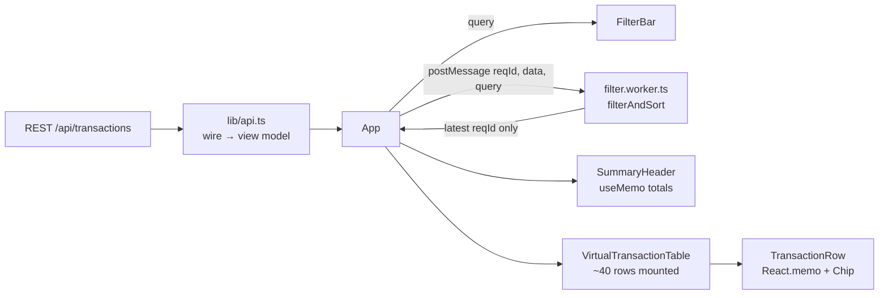

# Spend Dashboard — Performance Case Study

**A React + TypeScript spend-management dashboard built to stay responsive with 20,000 card transactions: virtualized rows, memoized components, filtering on a Web Worker, and on-screen instruments that make jank measurable.**

Finance teams live in transaction tables, and a table that freezes for a third of a second on every keystroke feels broken no matter how correct the numbers are. This project treats performance as an engineering discipline: build the naive version, instrument it, and fix only what the measurements point at.

## What's in the code

- **Virtualized table.** `VirtualTransactionTable` uses `@tanstack/react-virtual` with fixed 44px rows and an overscan of 8, so roughly 40 rows exist in the DOM regardless of dataset size. The naive `TransactionTable`, which mounts every row, is kept alongside it as the baseline.
- **Filtering off the main thread.** `filterAndSort` is a pure function. `useFilteredTxns` runs it in a module Web Worker and tags each request with an ID, discarding responses to stale queries so fast typing never applies an outdated result.
- **Memoization that actually works.** `TransactionRow` is wrapped in `React.memo`, the flag handler is a stable `useCallback`, and the summary totals are `useMemo`-derived.
- **Typed API boundary.** `lib/api.ts` is the only module that knows the snake_case wire format. It narrows untrusted strings into closed `Category`/`TxnStatus` unions and ISO dates into epoch numbers. Money stays in integer cents until a cell formats it.
- **Design-system primitive.** A `Chip` component driven by CSS custom properties, with tone colors annotated for WCAG AA contrast and an optional screen-reader label.
- **Built-in instruments.** `PerfProfiler` logs each React commit's `actualDuration` against `baseDuration`; `FrameMeter` shows a live dropped-frame count and worst frame gap.

## Measurements

The repo documents the method and the targets:

- [PERF_RUNBOOK.md](PERF_RUNBOOK.md) — how to measure with the React Profiler, the frame meter, the DevTools Performance panel, and Lighthouse.
- [PERF_BUDGET.md](PERF_BUDGET.md) — regression budgets (e.g. search-keystroke commit < 16 ms, Lighthouse ≥ 90, Total Blocking Time < 200 ms) and how to enforce them in CI.
- [PERF_RESULTS.md](PERF_RESULTS.md) — a before/after write-up of commit times, dropped frames, and Lighthouse scores for the naive and optimized tables.

> **Note:** the results in `PERF_RESULTS.md` can't currently be reproduced from a clone — the build scaffolding isn't committed and the source doesn't yet type-check (see *Status*).

## Architecture

| Path | Purpose |
|---|---|
| `src/lib/api.ts` | Typed fetch client for `GET /transactions` with keyset cursor |
| `src/lib/filterTxns.ts` | Pure filter + sort (never mutates input) |
| `src/workers/filter.worker.ts` | Runs `filterAndSort` on a separate thread |
| `src/hooks/useFilteredTxns.ts` | Worker lifecycle and stale-response dropping |
| `src/components/` | Summary header, filter bar, naive and virtualized tables, memoized row |
| `src/ds/` | `Chip` component and design tokens |
| `src/perf/` | `PerfProfiler` and `FrameMeter` |

## Tech stack

React · TypeScript · `@tanstack/react-virtual` · Web Workers · Vite (expected by `import.meta.env` and worker imports).

## Status

This repository contains the application source and write-ups, but not a runnable project yet:

- **No build scaffolding.** There's no `package.json`, `index.html`, Vite config, or `main.tsx` entry.
- **Doesn't type-check as committed.** The components come from different stages of the optimization: `App` passes `summary` to `SummaryHeader` (which expects `txns`) and `onFlag` to `VirtualTransactionTable` (which doesn't accept it), and neither table passes the `onFlag` that `TransactionRow` requires.
- **Needs a backend.** Data is fetched from `${VITE_API_BASE ?? "/api"}/transactions`; no mock server or fixture is included.

A sibling repository, [spend-dashboard-perf](https://github.com/AliAzamat/spend-dashboard-perf), is an earlier, smaller take on the same problem.
